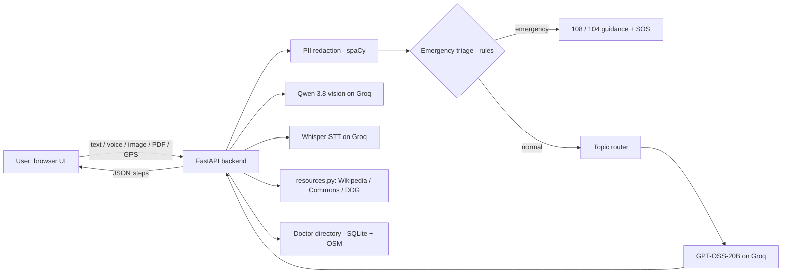

# The Smart Companion

**An AI health and daily-living companion for neurodivergent and vulnerable users: it turns overwhelming goals into small wins, sees and hears, and helps in an emergency.**

> Digital Twin Challenge 2026: Prototype & Code Submission

---

## 1. Team Details

| Name | Role | Email |
|------|------|-------|
| _Anwesha Mondol_ (Team Lead) | Frontent UI UX | _email_ |
| _Sandipan Dafadar_ | Speech-to-text, backend integration, AIML pipeline | _email_ |
| _Meghali Khan_ |Backend integration, vision, AI/LLM pipeline | _meghalikhan001@gmail.com_ |

## 2. College / Incubator Information

- **Institution:** _Techno India University_
- **Department:** _BTech CSE AIML(2023-27)_
- **City, State:** _Kolkata, West Bengal, India_

## 3. Project Title

**The Smart Companion: A Privacy-First, Multimodal AI Assistant for Neurodivergent Users, Extended into Everyday Healthcare**

## 4. Problem Statement

People with ADHD and other neurodivergent conditions often struggle with **task initiation** and **decision paralysis**. A goal such as "clean my room" or "prepare for my exam" feels like one giant mountain. Standard to-do apps and chatbots make this worse by returning long lists and walls of text.

The same difficulty extends to **health management**. Remembering medicines, tracking blood pressure or glucose, finding a nearby doctor, and reacting calmly in an emergency are hard for these users. They are also hard for the elderly and for people in under-served areas. Existing tools are either:

- too complex or overwhelming to use,
- locked behind paid services, or
- unsafe with personal data, because raw text is sent to AI services.

**Need:** one simple, friendly, free and privacy-safe assistant that guides one small step at a time, understands voice, photos, documents and live video, and supports health and safety.

## 5. Healthcare Use Case

The healthcare layer turns Smart Companion from a productivity helper into a **personal health companion**:

| Scenario | How Smart Companion helps |
|---|---|
| **Chronic condition self-management** (diabetes, hypertension) | Health Log records blood pressure, glucose and medicines in a low-effort screen designed for users who find forms overwhelming. |
| **Medical emergency** (chest pain, breathing trouble) | A deterministic danger detector spots emergency wording and shows 108 (ambulance) and 104 (health helpline) guidance immediately, with no AI delay. |
| **Needing help fast** | The SOS panel finds live GPS and the nearest hospitals, shows a map with drive, walk and transit routes, and prepares an alert message (location, map link and nearest hospital) for the user's saved contacts. The user sends it with one tap by SMS, WhatsApp or call. |
| **Finding care locally** | A self-built, free **doctor directory** (SQLite, seeded from OpenStreetMap, verified-first ranking) with WhatsApp appointment *requests*. |
| **Understanding medical documents** | Upload a prescription photo or a PDF report and ask questions in plain language, including scanned pages. |
| **Medical conversations** | Medical chats are routed to a dedicated mode with a safety-focused note, and recent Health Log readings are used as context. |

**Towards a personal health digital twin:** the Health Log and conversation memory form a lightweight, user-owned model of a person's health state (readings, medicines, history). Our roadmap builds on this with trend detection and personalised reminders. See *Future Scope*.

> **Disclaimer:** Smart Companion is an assistive prototype. It is **not** a medical device and does not diagnose. In an emergency, call 108/112.

## 6. Technical Stack

| Layer | Technology |
|---|---|
| **Backend** | Python 3.10+, FastAPI, Pydantic, Uvicorn |
| **Frontend** | HTML, CSS, vanilla JavaScript (Web Speech API, MediaRecorder, getUserMedia, Geolocation, localStorage) |
| **LLM (text)** | `openai/gpt-oss-20b` via Groq API |
| **Vision-language** | `qwen/qwen3.8-27b` (Alibaba Qwen) via Groq API |
| **Speech-to-text** | `whisper-large-v3-turbo` via Groq API |
| **Privacy** | spaCy `en_core_web_sm` named-entity recognition |
| **Computer vision** | OpenCV (IP camera stream), YOLOv8n (Ultralytics, fixed-class detection) |
| **Documents** | PyMuPDF (text extraction; scanned pages sent to the vision model) |
| **Database** | SQLite (doctor directory, appointment requests, emergency alert log) |
| **Maps and data** | OpenStreetMap (Overpass + Nominatim), Google Maps links, Wikipedia API, Wikimedia Commons API, DuckDuckGo search |

**Everything runs on free tiers and open data. No paid service is required.**

## 7. AI/ML Model and Framework Details

| Component | Model / method | Purpose | Why this choice |
|---|---|---|---|
| **Task decomposition** | GPT-OSS-20B (LLM) with a strict JSON-output prompt | Breaks goals into 3 small steps, asks clarifying questions, answers questions | Fast on Groq, open-weight, follows structured output well |
| **Vision-language Q&A** | Qwen 3.8 27B | Answers questions about photos and live camera frames, reads scanned pages, finds an object's position for the on-screen arrow | One model handles images, OCR and spatial grounding |
| **Speech-to-text** | Whisper large-v3-turbo | Converts spoken input to text | Accurate, multilingual, fast |
| **PII redaction** | spaCy NER (PERSON, ORG, GPE, LOC, DATE, TIME) | Removes personal details *before* text reaches any LLM | Runs locally, no data leaves the machine for this step |
| **Object detection** | YOLOv8n | Counts fixed-class objects in a photo | Lightweight, runs on CPU |
| **Topic routing** | Intent router (`router.py`) | Sorts each message into medical, exam, household or general and applies a mode-specific note | Keeps topics separate, with separate memory |
| **Emergency triage** | Deterministic keyword and rule engine (`triage.py`) | Detects emergency wording instantly | **Deliberately not an LLM**: it must be fast, predictable and never fail |
| **Resource finder** | Wikipedia, Commons and DuckDuckGo search APIs | Real links and images for every answer | Nothing is generated or invented |

**Reliability engineering around the LLM:** JSON extraction and repair; one retry without history if the model refuses; trimming to the requested step count; word-overlap repeat detection so tasks end properly; error replies are never saved into memory; context capping (last 4 turns and last 5 completed steps) to keep latency low.

**Privacy by design:** every request passes through the redaction layer first. No audio or images are stored on the server. Chats and the Health Log live in the user's own browser storage.

## 8. Key Features

**Core intelligence**
- Progressive micro-step breakdown (3 steps at a time), with time estimates and timers
- Clarifying questions to avoid decision paralysis
- Topic-sorted conversations, each with its own memory, and a delete option
- "Explore more": real links and images under each answer
- Streaks, badges and a progress tile

**Vision, voice and documents**
- **Live Camera Help** with laptop webcam or a phone as an IP camera, voice or typed questions, an arrow drawn on the video at the object, and an ambient scene-description mode
- Upload or take a photo and ask questions
- PDF question-answering, including scanned pages
- Voice input and read-aloud

**Healthcare and safety**
- Emergency detection (108 / 104)
- SOS panel: live GPS, nearby hospitals, map routes (drive / walk / transit), and a one-tap alert to saved contacts
- Free doctor directory with appointment requests
- Health Log (blood pressure, glucose, medicines)

**Neuro-inclusive design**
- Four text sizes, light, dark and auto themes, one task at a time, calm, friendly tone

## 9. System Architecture



The architecture diagram is also provided as a PDF in [`docs/`](d[ocs/](https://drive.google.com/file/d/1xiUcNMEqtVT41IFWxy2wj0AoFzB8CmhN/view?usp=sharing)).

### Endpoints (26)

| Area | Endpoints |
|---|---|
| Core | `GET /health`, `POST /redact`, `POST /decompose-task`, `POST /classify-session`, `POST /resources` |
| Voice | `POST /transcribe` |
| Vision | `POST /detect-objects`, `POST /caption-image`, `POST /guide-search` |
| Documents | `POST /upload-document`, `POST /ask-document` |
| IP camera | `GET /camera/status`, `POST /camera/set-url`, `GET /camera/stream`, `GET /camera/frame`, `POST /camera/ask`, `GET /camera/detect-objects`, `POST /camera/guide-search` |
| Healthcare | `POST /nearby-healthcare`, `GET /directory/search`, `GET /directory/geocode`, `POST /directory/doctors`, `POST /directory/doctors/{id}/verify`, `POST /directory/appointments`, `POST /directory/alert`, `GET /directory/alerts` |

Interactive API docs are available at `http://127.0.0.1:8000/docs` after starting the server.

## 10. Project Structure

```
smart-companion/
├── backend/
│   ├── app/            # app.py, llm.py, models.py, redact.py, router.py, triage.py,
│   │                   # resources.py, doctor_directory.py, nearbydoc.py
│   ├── visual/         # vision.py, caption.py, guide.py, ip_camera.py, pdfqa.py
│   ├── speech_to_text/ # speech.py
│   └── .env            # API keys (not committed)
├── frontend/           # index.html, app.js, style.css
├── docs/               # Architecture diagram (PDF), presentation (PPT/PDF), report
├── LICENSE
└── README.md
```

## 11. Installation and Run

```bash
# 1. Clone
git clone https://github.com/<your-username>/<repo-name>.git
cd <repo-name>/backend

# 2. Environment
python -m venv venv
source venv/bin/activate          # Windows: venv\Scripts\activate
pip install -r requirements.txt
python -m spacy download en_core_web_sm

# 3. API key (free at console.groq.com)
echo "GROQ_API_KEY=your_key_here" > .env
# optional: CAMERA_URL=http://<phone-ip>:8080/video   (IP Webcam app)

# 4. Start backend (run from the backend/ folder)
uvicorn app.app:app --reload --port 8000

# 5. Start frontend (new terminal)
cd ../frontend
python -m http.server 5500
# open http://127.0.0.1:5500
```

On first use of the doctor directory, the app seeds nearby facilities from OpenStreetMap (internet needed once per area).

## 12. Demo Video

**Unlisted YouTube link (15-20 min demo):** _[ADD LINK HERE]_

The video covers the problem, a full live demo (task breakdown, voice, live camera, PDF Q&A, SOS, doctor directory, Health Log), the architecture and the AI pipeline, and the roadmap.

## 13. Open-Source License Details

This project is released under the **MIT License** (see [`LICENSE`](LICENSE)).

Third-party components and data keep their own licenses:

| Component | License |
|---|---|
| FastAPI, Pydantic, spaCy, OpenCV (4.5+), PyMuPDF* | MIT / BSD / Apache-2.0 / AGPL* |
| Ultralytics YOLOv8 | AGPL-3.0 |
| OpenStreetMap data | ODbL: "© OpenStreetMap contributors" |
| Wikipedia text | CC BY-SA |
| Wikimedia Commons images | Individual licenses, linked from each image |
| Groq-hosted models (GPT-OSS, Qwen, Whisper) | Used through the Groq API under the respective model licenses |

\* PyMuPDF is AGPL-3.0 and YOLOv8 (Ultralytics) is AGPL-3.0. They are used as libraries for this open-source prototype.

## 14. Presentation and Architecture Diagram
 

 
All files below are hosted on Google Drive with access set to **"Anyone with the link: Viewer"**, so they open with a single click and need no login or permission request.
 
| Item | Format | Link |
|---|---|---|
| Architecture diagram | PDF | [Open architecture diagram](https://drive.google.com/file/d/1xiUcNMEqtVT41IFWxy2wj0AoFzB8CmhN/view?usp=sharing) |
| Presentation (project details and outcomes) | PDF / PPT | [Open presentation](https://drive.google.com/file/d/1LYUC2jc42Ey0EUwjk-3pAEbNMddTUrnZ/view?usp=sharing) |
 
Backup copies of the architecture diagram are also in this repository: [`docs/architecture.pdf`](docs/architecture.pdf) and [`docs/architecture.png`](docs/architecture.png).


## 15. Impact and Outcomes

- **26 API endpoints** and **3 AI model families** working together in one app
- **Zero paid services**: runs on free tiers and open data
- **Privacy-first**: personal details are removed before any AI call
- **Safe by design**: emergency detection is rule-based, so it is instant and predictable, and alerts are always user-initiated
- **Accessible**: text-size control, one task at a time, voice in and out, minimal typing

## 16. Limitations (Honest Notes)

- Doctor data comes from OpenStreetMap, so coverage and phone numbers vary by area. Appointment *requests* open WhatsApp and are not confirmed bookings.
- SOS prepares the message and the user taps to send it. We do not send silent automatic alerts.
- The LLM can make mistakes. Health answers are informational only.
- Free API tiers have rate limits.

## 17. Future Scope

- Daily wellness reminders (medicines, readings) and trend detection on Health Log data, extending towards a fuller personal health digital twin
- Voice-only mode for blind users and a visual, text-first mode for deaf users
- Caregiver features and medicine-photo recognition
- A crisis-support flow that shows helplines first and offers a one-tap contact the user chooses
- Native mobile app, local-language support, and wider verified doctor coverage

## 18. Acknowledgements

Google, Youtube, Groq, OpenStreetMap contributors, Wikimedia Foundation, and the open-source community.

---

*Built by Team _Name_ for the Digital Twin Challenge 2026.*
